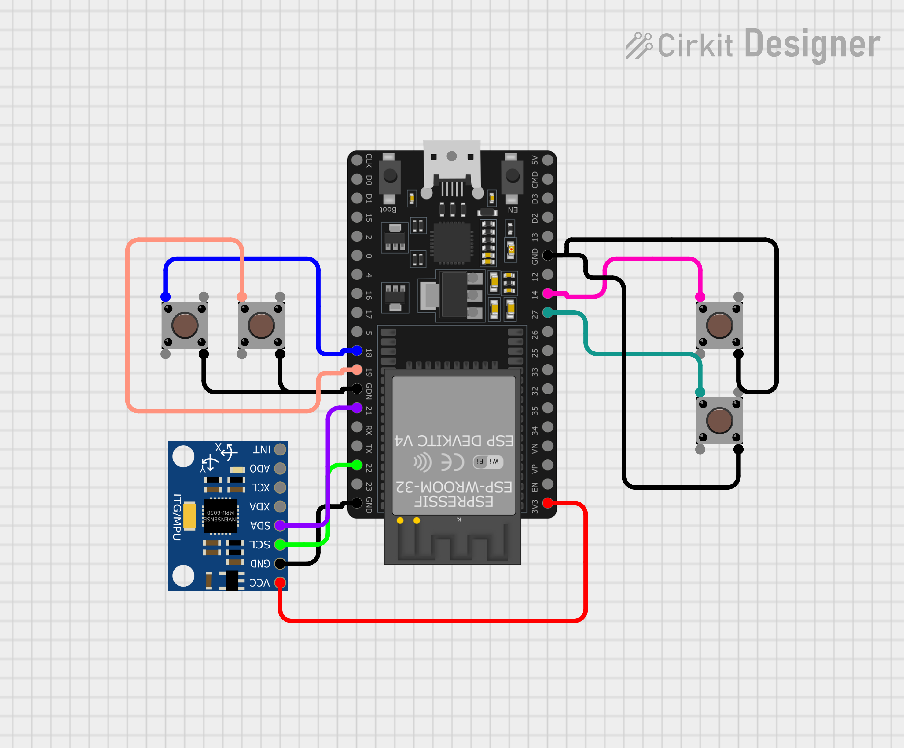

# ESP32 BLE Air Mouse

Transform your ESP32 and MPU6050 into a high-precision motion-controlled Bluetooth mouse. This project uses the built-in Bluetooth Low Energy (BLE) capabilities of the ESP32 to act as a standard HID (Human Interface Device), allowing you to control your computer cursor smoothly in 3D space with zero host software or drivers required.



## Features

- **Motion Control**: High-precision cursor movement driven by MPU6050 gyroscope tracking (Yaw and Pitch).
- **Auto-Calibration on Boot**: Measures zero-rate drift at startup, completely eliminating stationary cursor creep.
- **Dynamic Sensitivity and EMA Filter**: Exponential Moving Average smoothing absorbs hand tremors, while non-linear scaling accelerates the pointer during quick flicks.
- **Click Deflection Stabilization**: Briefly freezes cursor jitter upon button press so clicks land reliably on target without shifting.
- **Non-Blocking Smooth Scrolling**: Dedicated Up/Down buttons scroll without stuttering or stopping cursor tracking.
- **Smart Multi-Button Combos**:
  - **Middle Click**: Press **Left + Right Click** simultaneously.
  - **DPI Switcher**: Hold **Scroll Up** and tap **Left Click** to cycle sensitivity between **Low (Sniper 5.0)**, **Medium (Standard 10.0)**, and **High (Fast 16.0)**.
  - **Clutch Mode (Pause Tracking)**: Hold **Scroll Up + Scroll Down** together to freeze the cursor while repositioning your hand in the air.
- **Intelligent Power Management**: Polling rate automatically drops into low-power idle if stationary for over 2 minutes.
- **Universal Compatibility**: Works out-of-the-box on Windows, macOS, Linux, Android, and iOS.

---

## Controls and Button Shortcuts

| Action | Control / Combination | Description |
| :--- | :--- | :--- |
| **Move Cursor** | Tilt / Wave in Air | Gyroscope-guided 2D cursor control |
| **Left Click** | Left Button | Standard Left Click (with jitter stabilization) |
| **Right Click** | Right Button | Standard Right Click (with jitter stabilization) |
| **Scroll Up / Down** | Scroll Buttons | Smooth continuous vertical scrolling |
| **Middle Click** | **Left + Right** together | Opens links in new tabs, closes tabs, etc. |
| **DPI Cycle** | **Hold Scroll Up + Click Left** | Toggles Low (Sniper) to Medium to High DPI |
| **Clutch (Pause Tracking)**| **Hold Scroll Up + Scroll Down** | Freezes cursor to reposition hand comfortably |

---

## How to Build Your Own Air Mouse

Follow these step-by-step instructions to assemble and start using your ESP32 Air Mouse.

### Step 1: Gathering Materials
You will need:
- **ESP32 Development Board** (30-pin or 38-pin version)
- **MPU6050 Sensor Module** (6-axis Accelerometer + Gyroscope)
- **4x Momentary Push Buttons** (for Left, Right, Scroll Up, Scroll Down)
- **Small Breadboard** or **Perfboard**
- **Jumper Wires**

### Step 2: Wiring the Circuit
Looking at the [Air_Mouse.png](Air_Mouse.png) diagram, connect the components as follows:

1. **Connect the MPU6050**:
   - VCC -> ESP32 **3V3**
   - GND -> ESP32 **GND**
   - SCL -> ESP32 **GPIO 22**
   - SDA -> ESP32 **GPIO 21**
2. **Connect the 4 Buttons**:
   - Connect one side of every button to **GND**.
   - Connect the opposite pin of each button to its assigned GPIO:
     - **Left Click** -> GPIO **18**
     - **Right Click** -> GPIO **19**
     - **Scroll Up** -> GPIO **14**
     - **Scroll Down** -> GPIO **27**

### Step 3: Setting Up Arduino IDE
1. **Install Arduino IDE**: [Download Arduino IDE](https://www.arduino.cc/en/software).
2. **Add ESP32 Support**: 
   - Go to `File > Preferences`.
   - In "Additional Boards Manager URLs," paste: `https://dl.espressif.com/dl/package_esp32_index.json`
   - Go to `Tools > Board > Boards Manager`, search for **"esp32"**, and install the package by Espressif Systems.
3. **Install Required Libraries**:
   - Go to `Sketch > Include Library > Manage Libraries...`
   - Search for and install **"ESP32 BLE Mouse"** (by T-vK).
   - Search for and install **"Adafruit MPU6050"** (click **Install All** to automatically pull in `Adafruit Unified Sensor` and `Adafruit BusIO`).

### Step 4: Flashing the Code
1. Connect your ESP32 board to your computer with a data USB cable.
2. Open `Air_Mouse.ino` in Arduino IDE.
3. Select your board under `Tools > Board` (e.g., **"DOIT ESP32 DEVKIT V1"**).
4. Select the correct serial port under `Tools > Port`.
5. Click the **Upload** button.
   - *Tip:* If the terminal says "Connecting...", press and hold the **BOOT** button on the ESP32 until the flashing percentage begins.

### Step 5: Calibration and Bluetooth Pairing
1. **On Boot Calibration**: Keep the Air Mouse still on a flat surface for 1 to 2 seconds immediately after powering on while it measures and eliminates zero-rate gyro drift.
2. Open Bluetooth settings on your PC, Mac, or phone and scan for devices.
3. Connect to **"ESP32 BLE Mouse"**.
4. Start moving and clicking.

---

## Technical Architecture

The firmware utilizes angular velocity from the **Gyroscope (degrees/sec)** instead of raw accelerometer tilts for an intuitive, zero-lag "laser-pointer" feel:
- **Yaw (Z-axis)** -> Horizontal Movement (X)
- **Pitch (Y-axis)** -> Vertical Movement (Y)

```cpp
// Dynamic sensitivity calculation
float dynamicSensitivity = baseSensitivity * (1.0 + speed * 0.2);

// Low-Pass Exponential Moving Average (EMA)
smoothX = (alpha * moveX) + ((1.0 - alpha) * smoothX);
smoothY = (alpha * moveY) + ((1.0 - alpha) * smoothY);
```

---

## License
This project is open-source and available under the [MIT License](LICENSE).
